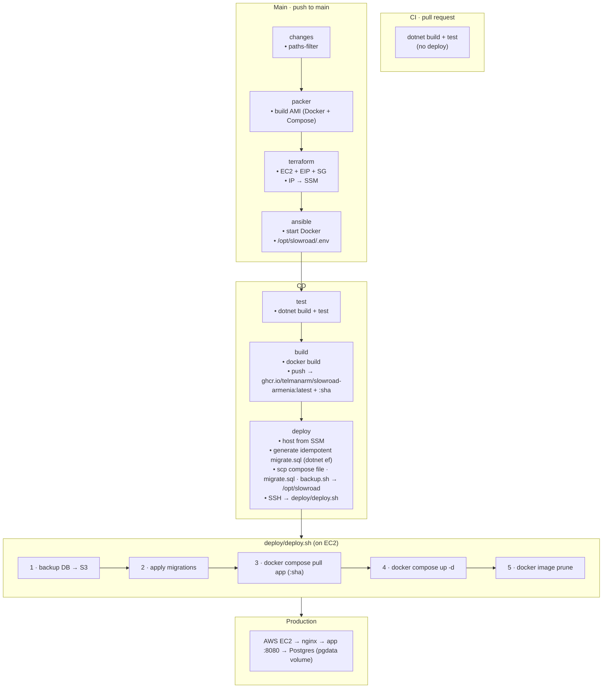

# The Slow Road Armenia

A travel guide to Armenia — built with ASP.NET Core MVC and shipped to AWS EC2
through a fully automated Packer + Terraform + Ansible + Docker + GitHub Actions
pipeline.

### 🌐 Live: [slowroadarmenia.com](https://slowroadarmenia.com/)

---

## Stack

| Layer | Tech |
|---|---|
| App | .NET 9 · ASP.NET Core MVC · EF Core · ASP.NET Identity |
| Data | PostgreSQL 16 · S3 (backups) |
| Image | Packer → custom AMI (Amazon Linux 2023 + Docker + Compose) |
| Infra | Terraform (EC2 + Elastic IP + security group, S3 state) · SSM Parameter Store |
| Config | Ansible |
| Ship | Docker Compose · GitHub Actions · GHCR · AWS OIDC |
| Run | AWS EC2 (`eu-north-1`) · nginx |

---

## Repository layout

| Path | What's there |
|---|---|
| `SlowRoad/` | The web app: controllers, Razor views, EF Core models & migrations |
| `SlowRoad.Tests/` | xUnit integration tests (`WebApplicationFactory` + EF InMemory) |
| `packer/` | AMI template — base image with Docker and Docker Compose |
| `infra/` | Terraform — EC2 instance from the latest `slowroad-base-*` AMI, writes its IP to SSM |
| `ansible/` | Playbook — starts Docker, creates `/opt/slowroad`, writes `.env` |
| `deploy/` | Production compose file, `deploy.sh` and `backup.sh` (run on EC2) |
| `.github/workflows/` | CI, the `Main` orchestrator and its reusable stages |
| `Dockerfile` | Multi-stage app image |
| `docker-compose.yml` | Local Postgres for development |

---

## App

- **Public site** — home page built from editable sections (hero, why visit,
  destinations, featured, plan, about), destination pages at `/destinations/{slug}`.
- **Photos** — stored in the database at several widths and served from
  `/photos/{id}/{width}` (cached 7 days).
- **Admin** — `/Admin` (cookie login via ASP.NET Identity) to create, edit and
  delete places and upload, order and remove their photos. The admin user is
  seeded on startup from `Admin:Email` / `Admin:Password`.

---

## Run locally

```bash
docker compose up -d                       # Postgres on localhost:5432
dotnet tool restore                        # dotnet-ef
dotnet ef database update --project SlowRoad
dotnet user-secrets set "Admin:Email"    "you@example.com" --project SlowRoad
dotnet user-secrets set "Admin:Password" "..."             --project SlowRoad
dotnet run --project SlowRoad
dotnet test                                # run the test suite
```

The local connection string lives in `appsettings.Development.json`.

---

## Pipeline

- **CI** (`ci.yml`) — every pull request to `main`: `dotnet build + test`. No deploy.
- **Main** (`main.yml`) — every push to `main`. Detects which folders changed and
  runs only the stages that need it, each gating the next:

| Stage | Workflow | Runs when | Does |
|---|---|---|---|
| Packer | `packer.yml` | `packer/**` changed | Builds a new `slowroad-base-<timestamp>` AMI |
| Terraform | `terraform.yml` | `packer/**` or `infra/**` changed | `plan` + `apply` (apply on `main` only); new AMI → instance replaced |
| Ansible | `ansible.yml` | `packer/**`, `infra/**` or `ansible/**` changed | Configures the host and writes `.env` |
| CD | `cd.yml` | Always (unless an earlier stage failed) | Test → build image → deploy |

Every workflow can also be run on its own from the Actions tab (`workflow_dispatch`).
AWS access uses GitHub OIDC (`AWS_ROLE_ARN`) — no long-lived AWS keys. The EC2
address is read from SSM (`/slowroad/dev/ec2_host`), which Terraform keeps up to date.



Deploys use the exact commit SHA image, so any deploy maps to one commit and can
be rolled back. The container binds to `127.0.0.1` only — nothing is exposed
except through nginx. Runs are serialized (`concurrency`) so deploys can't land
out of order.

---

## Infrastructure

- **Terraform state** — S3 bucket `slowroad-tfstate-gtslowroad` with native S3
  locking. Create it once with `infra/create-state-bucket.sh`.
- **EC2** — `t3.micro` in the default subnet of `eu-north-1a`, Elastic IP,
  ports 22 / 80 / 443 open (`ssh_allowed_cidr` restricts SSH).
- **AMI** — always the newest self-owned `slowroad-base-*` image; a new Packer
  build replaces the instance on the next Terraform apply, and Ansible + CD then
  set it up again from scratch.

---

## Docker

Multi-stage build: the SDK image restores and publishes, the slim ASP.NET
runtime image carries only the published output — smaller image, no build tools
in production. The app needs Postgres to run.

---

## Configuration

Secrets are never committed.

**GitHub repo secrets**
`AWS_ROLE_ARN` · `EC2_USER` · `EC2_SSH_KEY` ·
`POSTGRES_USER` · `POSTGRES_PASSWORD` · `POSTGRES_DB` ·
`ADMIN_EMAIL` · `ADMIN_PASSWORD` · `BACKUP_BUCKET`

**Server `/opt/slowroad/.env`** (written by Ansible from the secrets above)
`POSTGRES_USER` · `POSTGRES_PASSWORD` · `POSTGRES_DB` ·
`ConnectionStrings__Default` · `Admin__Email` · `Admin__Password` · `BACKUP_BUCKET`

GHCR pulls on the server use the deploy job's short-lived `GITHUB_TOKEN`; the
server logs out right after pulling.

---

## Database & migrations

On deploy, CD generates an idempotent SQL script and applies it **after** a
backup and **before** the new app starts. (Setting `RunMigrations=true` makes the
app migrate on startup instead — off by default.)

---

## Backups

- **Automatic** before every deploy
- **Manual** on EC2: `bash /opt/slowroad/backup.sh`
- Stored gzipped in `s3://$BACKUP_BUCKET/postgres/`; last 2 kept on the server

---

## Rollback

Deploys are pinned to the exact commit SHA image, so an older SHA can be brought
back. Migrations are **not** rolled back — if the schema changed, restore from a
backup.

---

## Branches

| Branch | Role |
|---|---|
| `develop` | Daily work; feature branches merge here |
| `main` | Production; PR from `develop` runs CI, merge runs the Main pipeline |
