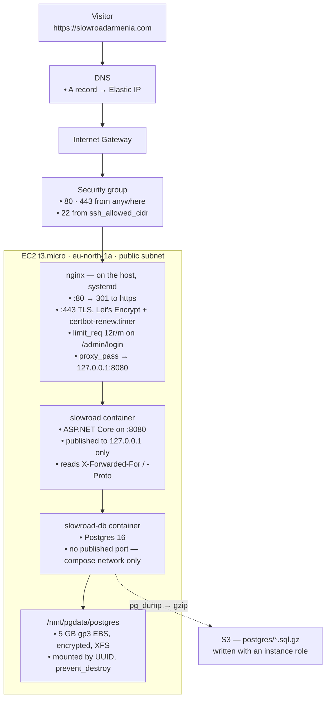
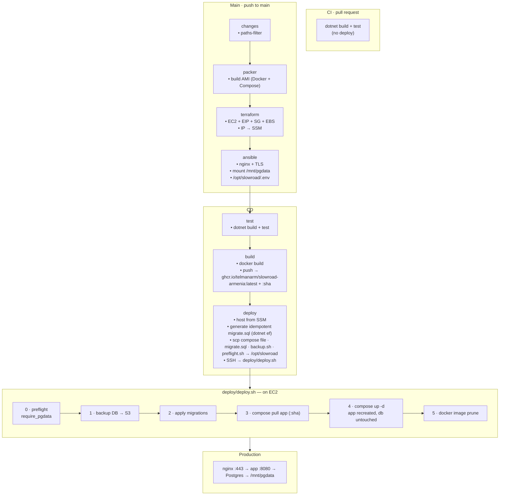

<p align="center">
  <a href="https://slowroadarmenia.com/">
    
  </a>
</p>

<h1 align="center">The Slow Road Armenia</h1>

<p align="center">
  A travel guide to Armenia — ASP.NET Core MVC, shipped to AWS on an
  immutable-image pipeline built from Packer, Terraform, Ansible, Docker and GitHub Actions.
</p>

<p align="center">
  <a href="https://slowroadarmenia.com/"><strong>slowroadarmenia.com&nbsp;→</strong></a>
</p>

<p align="center">
  <a href="https://github.com/TelmanArm/slowroad-armenia/actions/workflows/ci.yml"></a>
  <a href="https://github.com/TelmanArm/slowroad-armenia/actions/workflows/main.yml"></a>
  <a href="https://github.com/TelmanArm/slowroad-armenia/actions/workflows/backup.yml"></a>
</p>

<p align="center">
  
  
  
  
  
</p>

---

## Contents

| | |
|---|---|
| [Overview](#overview) | What this is and what it runs on |
| [Architecture](#architecture) | How a live request reaches the app |
| [The application](#the-application) | Routes, photos, analytics, admin |
| [Security](#security) | What protects the admin login |
| [Repository layout](#repository-layout) | Where everything lives |
| [Local development](#local-development) | Run it on your machine |
| [Delivery pipeline](#delivery-pipeline) | CI, the Main orchestrator, CD |
| [Infrastructure](#infrastructure) | Terraform, Packer, the data volume |
| [Configuration](#configuration) | Secrets and environment |
| [Database & migrations](#database--migrations) | How schema changes are applied |
| [Backups & restore](#backups--restore) | Automatic, weekly, manual |
| [Rollback](#rollback) | Getting back to a known good state |
| [Operations](#operations) | Commands you'll actually use |
| [Testing](#testing) | What the suite covers |
| [Branches](#branches) | How work reaches production |

---

## Overview

A content-managed travel site: an editable home page, destination pages, and a
photo library the owner maintains from a small admin area. One `t3.micro` in
`eu-north-1` serves it, and every layer below the app is defined in code — the
machine image, the instance, the host configuration, the containers and the
deploy itself.

| | Layer | Tech |
|:--:|---|---|
|  | **App** | .NET 9 · ASP.NET Core MVC · EF Core · ASP.NET Identity · SkiaSharp |
|  | **Data** | PostgreSQL 16 on a dedicated EBS volume · S3 for backups |
|  | **Image** | Packer → custom AMI (Amazon Linux 2023 + Docker + Compose) |
|  | **Infra** | Terraform (EC2, Elastic IP, security group, EBS, IAM, SSM) · S3 remote state |
|  | **Config** | Ansible (nginx, TLS, mounts, `.env`) |
|   | **Ship** | Docker Compose · GitHub Actions · GHCR · AWS OIDC |
|  ☁️ | **Run** | AWS EC2 `eu-north-1a` · nginx on the host · app and Postgres in containers |

**Design principles the setup follows**

- **Nothing is configured by hand.** The server can be destroyed and rebuilt
  from the repository; the only state that must survive is the EBS data volume.
- **Immutable images.** A Packer build produces a new AMI, Terraform replaces
  the instance, Ansible and CD set it up again from scratch.
- **One deploy maps to one commit.** Images are pinned to the commit SHA.
- **Nothing is exposed but nginx.** The app publishes on `127.0.0.1`, Postgres
  publishes no port at all.
- **No long-lived AWS keys.** GitHub Actions assumes a role through OIDC.

---

## Architecture

Everything public is one instance in a public subnet. nginx runs on the host;
the app and Postgres run as containers behind it, reachable only from localhost.



**Hop by hop**

| Hop | What happens |
|---|---|
| **DNS** | `slowroadarmenia.com` resolves to the Elastic IP, so the address survives instance replacement |
| **Internet Gateway** | The VPC's only route to the internet; without it a public IP is unreachable |
| **Security group** | AWS-level firewall. 80 and 443 open to the world, 22 restricted to `ssh_allowed_cidr`. Nothing else gets in |
| **nginx :80** | Redirects every request to HTTPS (`301`) |
| **nginx :443** | Terminates TLS, throttles `/admin/login`, proxies to the app and passes the real client IP in `X-Forwarded-For` |
| **App :8080** | Routing, Identity cookie auth, EF Core. Bound to `127.0.0.1`, so the only way in is through nginx |
| **Postgres** | Reached over the Docker network by service name — no port is published to the host |
| **EBS volume** | Data lives outside the container and outside the root disk, so image swaps and `compose down` never touch it |

The response travels back the same way: app → nginx (TLS) → Internet Gateway → visitor.

**Why the app trusts the forwarded headers.** Behind nginx the connection's
remote address is the proxy, not the visitor — so without
`UseForwardedHeaders` every request on earth would share one rate-limit bucket
and `Request.IsHttps` would be wrong. `ForwardLimit` is `1` and only private
ranges are trusted; since the container publishes on `127.0.0.1` only, a forged
header cannot reach the app from outside.

**Surviving a reboot.** nginx is `enabled` in systemd, both containers are
`restart: unless-stopped`, and a `RequiresMountsFor=/mnt/pgdata` drop-in stops
Docker from starting before the data volume is mounted — so Postgres never
comes up pointing at an empty directory.

---

## The application

**Public site** — a home page assembled from editable sections (hero, why
visit, destinations, featured, plan, about) and destination pages generated
from the database.

| Route | Controller | Purpose |
|---|---|---|
| `/` | `HomeController` | Home page, built from `Section` / `SectionItem` content |
| `/destinations` | `DestinationsController` | Index of places |
| `/destinations/{slug}` | `DestinationsController` | One destination, its photos and details |
| `/photos/{id}/{width}` | `PhotosController` | Stored image bytes, cached 7 days |
| `/Admin` · `/Admin/Login` | `AdminController` | Cookie login and dashboard |
| `/Places/…` | `PlacesController` | Authorized CRUD — create, edit, delete places; upload, reorder and remove photos |

**Photos** — uploads are resized on the way in by `ImageProcessor`
(SkiaSharp), stored in Postgres as real variants at **700 px and 1400 px**, and
served from `/photos/{id}/{width}`. Nothing is upscaled: a photo narrower than a
target is stored once at its own width and the controller falls back to the
widest row it has, so `srcset` never promises a resolution that doesn't exist.
EXIF rotation is applied at upload time, and oversized images are rejected by a
pixel-count ceiling.

**Analytics** — Google Analytics 4, rendered from `_Layout.cshtml` only when
`Analytics:MeasurementId` is set and the environment is not Development, so
local browsing stays out of the numbers. One page view per page, no custom
events, and the admin layout carries no tag.

**Admin** — `/Admin`, cookie login via ASP.NET Identity. The admin user is
seeded on startup from `Admin:Email` / `Admin:Password`.

---

## Security

The admin login is the only attack surface that matters, so it is defended at
three levels — each one cheaper than the next.

| | Level | Control | Effect |
|:--:|---|---|---|
|  | **nginx** | `limit_req zone=login rate=12r/m burst=5 nodelay` | A brute-force run is dropped at the proxy, before it costs the app a single password hash. Returns `429` |
|  | **App** | Per-IP fixed-window rate limiter (`PermitLimit 10` / `WindowMinutes 5`) | `/Admin/Login` stops answering that IP entirely. Sends `Retry-After` |
| 🔐 | **Identity** | Account lockout (`MaxFailedAttempts 10`, `LockoutMinutes 1`) | Guessing against one account stalls |

The lockout is deliberately short: with a single admin account a long hard lock
is its own denial of service — anyone could hold the owner out of their site.
The per-IP limit is the control that actually makes unlimited guessing
impossible.

Also in place: HSTS and the exception handler outside Development, HTTPS
redirection, anti-forgery tokens on admin POSTs, `[Authorize]` on
`AdminController` and `PlacesController`, secrets never committed, and a
Postgres password that Terraform generates once and keeps in SSM as a
`SecureString`.

Tunables live in `Security:Login` (`appsettings.json`), bound through
`LoginSecurityOptions` so tests can exercise each control independently.

---

## Repository layout

| Path | What's there |
|---|---|
| `SlowRoad/` | The web app — controllers, Razor views, EF Core models and migrations, `ImageProcessor`, `Program.cs` |
| `SlowRoad.Tests/` | xUnit integration tests (`WebApplicationFactory` + EF InMemory) |
| `packer/` | AMI template — base image with Docker and Docker Compose |
| `infra/` | Terraform — EC2 from the latest `slowroad-base-*` AMI, Elastic IP, EBS, IAM, SSM |
| `ansible/` | Playbook — nginx, Let's Encrypt, the data-volume mount, `/opt/slowroad/.env` |
| `deploy/` | `docker-compose.prod.yml`, `deploy.sh`, `backup.sh`, `preflight.sh` (run on EC2) |
| `.github/workflows/` | `ci` · `main` orchestrator · `packer` · `terraform` · `ansible` · `cd` · `backup` |
| `Dockerfile` | Multi-stage app image |
| `docker-compose.yml` | Local Postgres for development |

---

## Local development

```bash
docker compose up -d                       # Postgres on localhost:5432
dotnet tool restore                        # dotnet-ef
dotnet ef database update --project SlowRoad
dotnet user-secrets set "Admin:Email"    "you@example.com" --project SlowRoad
dotnet user-secrets set "Admin:Password" "..."             --project SlowRoad
dotnet run --project SlowRoad
```

```bash
dotnet test
```

The local connection string lives in `appsettings.Development.json`. Analytics
stays off in Development, so local page views never reach GA4.

---

## Delivery pipeline

**CI** (`ci.yml`) — every pull request to `main`: `dotnet build + test`. No deploy.

**Main** (`main.yml`) — every push to `main`. `dorny/paths-filter` works out
which folders changed and runs only the stages that need it, each gating the
next. Runs are serialized (`concurrency: main`) so deploys can't land out of
order, and `README.md`-only pushes are ignored.

| | Stage | Workflow | Runs when | Does |
|:--:|---|---|---|---|
|  | **Packer** | `packer.yml` | `packer/**` changed | Builds a new `slowroad-base-<timestamp>` AMI |
|  | **Terraform** | `terraform.yml` | `packer/**` or `infra/**` changed | `plan` + `apply` (apply on `main` only); a new AMI replaces the instance |
|  | **Ansible** | `ansible.yml` | `packer/**`, `infra/**` or `ansible/**` changed | Configures the host, issues/renews TLS, writes `.env` |
|  | **CD** | `cd.yml` | App code changed, or Ansible ran | Test → build image → deploy |

Every workflow can also be run on its own from the Actions tab
(`workflow_dispatch`). AWS access uses GitHub OIDC (`AWS_ROLE_ARN`) — no
long-lived keys. The EC2 address is read from SSM
(`/slowroad/dev/ec2_host`), which Terraform keeps up to date.



**The deploy refuses to run on a wrong host.** `preflight.sh` checks that
`/mnt/pgdata` is actually mounted and that it holds a Postgres cluster
(`PG_VERSION`); a first install has to opt in with `ALLOW_INIT=1`. That is what
stops a fresh instance from quietly initialising an empty database over a real
one. GHCR pulls on the server use the deploy job's short-lived `GITHUB_TOKEN`,
and the server logs out of the registry immediately afterwards.

---

## Infrastructure

**Terraform** — state in the S3 bucket `slowroad-tfstate-gtslowroad` with
native S3 locking; create it once with `infra/create-state-bucket.sh`.

| Resource | Detail |
|---|---|
| EC2 | `t3.micro` via `terraform-aws-modules/ec2-instance` v6.4.1, default subnet of `eu-north-1a`, `ignore_ami_changes` so a new AMI is a deliberate replacement |
| Elastic IP | `create_eip` — the public address outlives the instance |
| Security group | Ingress 22 (`ssh_allowed_cidr`), 80, 443 |
| EBS `slowroad-pgdata` | 5 GB gp3, encrypted, `final_snapshot`, `prevent_destroy`, attached at `/dev/sdf` |
| IAM | Instance profile `slowroad-ec2` with a policy scoped to `s3:PutObject`/`GetObject` on `<backup_bucket>/postgres/*` — nothing wider |
| SSM | `/slowroad/dev/ec2_host` (String) · `/slowroad/dev/postgres_password` (SecureString) |
| `random_password` | 32 chars, `prevent_destroy` — Postgres reads its password only on first init, so it must never change |

**AMI** — always the newest self-owned `slowroad-base-*` image, built by Packer
from the newest `al2023-ami-2023*-x86_64` with Docker and Compose v2.29.7 baked in. A new build replaces
the instance on the next apply; Ansible and CD then rebuild the host from
scratch.

**Docker** — multi-stage build: the SDK image restores and publishes, the slim
ASP.NET runtime image carries only the published output. Smaller image, no
build tools in production.

---

## Configuration

Secrets are never committed.

**GitHub repository secrets**

`AWS_ROLE_ARN` · `EC2_USER` · `EC2_SSH_KEY` ·
`POSTGRES_USER` · `POSTGRES_PASSWORD` · `POSTGRES_DB` ·
`ADMIN_EMAIL` · `ADMIN_PASSWORD` · `BACKUP_BUCKET`

**Server `/opt/slowroad/.env`** — written by Ansible from the secrets above

`POSTGRES_USER` · `POSTGRES_PASSWORD` · `POSTGRES_DB` ·
`ConnectionStrings__Default` · `Admin__Email` · `Admin__Password` · `BACKUP_BUCKET`

**App settings worth knowing**

| Key | Default | Meaning |
|---|---|---|
| `Security:Login:PermitLimit` | `10` | Login attempts per IP per window |
| `Security:Login:WindowMinutes` | `5` | Length of that window |
| `Security:Login:MaxFailedAttempts` | `10` | Failures before an account locks |
| `Security:Login:LockoutMinutes` | `1` | How long the lock lasts |
| `Analytics:MeasurementId` | set | GA4 tag; omit to disable |
| `RunMigrations` | unset | `true` makes the app migrate on startup instead of CD |

---

## Database & migrations

On deploy, CD generates an **idempotent** SQL script with `dotnet ef migrations
script` and applies it **after** the backup and **before** the new app starts —
so the schema is always ahead of the code that needs it, and re-running a deploy
is harmless.

Setting `RunMigrations=true` makes the app migrate on startup instead. Off by
default: with migrations in the deploy step, a failure is visible in the
pipeline rather than in a crash-looping container.

---

## Backups & restore

| | When | How |
|:--:|---|---|
| 🚀 | **Before every deploy** | `deploy.sh` calls `backup.sh deploy` as its first real step |
| 🗓️ | **Weekly** | `backup.yml` — Sundays 02:00 UTC (06:00 Armenia), over SSH, host from SSM |
| ⌨️ | **Manual** | `bash /opt/slowroad/backup.sh` on the server |

Dumps are written to `.tmp` first and renamed only on success, so a failed dump
never looks complete. They are gzipped straight to
`s3://$BACKUP_BUCKET/postgres/` using the instance role, and only then are older
local dumps pruned — the two newest stay on the box.

The weekly workflow also **verifies** itself: it asks S3 for the newest object
under `postgres/` and fails the run if it is more than 192 hours old. A backup
job that silently stopped working would otherwise look exactly like a healthy one.

**Restore**

```bash
cd /opt/slowroad
aws s3 cp s3://$BACKUP_BUCKET/postgres/<file>.sql.gz - | gunzip > restore.sql
docker compose -f docker-compose.prod.yml exec -T db \
  sh -c 'psql -v ON_ERROR_STOP=1 -U "$POSTGRES_USER" -d "$POSTGRES_DB"' < restore.sql
```

---

## Rollback

Deploys are pinned to the exact commit SHA image, so an older SHA can be brought
back by re-running CD at that commit, or on the box:

```bash
cd /opt/slowroad && IMAGE=ghcr.io/telmanarm/slowroad-armenia SHA=<old-sha> docker compose -f docker-compose.prod.yml up -d
```

Migrations are **not** rolled back. If the schema changed, restore from the
backup the deploy took before it.

---

## Operations

```bash
ssh $EC2_USER@$(aws ssm get-parameter --name /slowroad/dev/ec2_host --query Parameter.Value --output text)
```

| Task | Command |
|---|---|
| Container status | `docker compose -f /opt/slowroad/docker-compose.prod.yml ps` |
| App logs | `docker logs -f slowroad` |
| DB logs | `docker logs -f slowroad-db` |
| psql shell | `docker compose -f /opt/slowroad/docker-compose.prod.yml exec db psql -U "$POSTGRES_USER" -d "$POSTGRES_DB"` |
| nginx state | `sudo systemctl status nginx` · `sudo nginx -t` |
| TLS expiry | `sudo certbot certificates` |
| Renewal timer | `systemctl list-timers certbot-renew.timer` |
| Data volume | `findmnt /mnt/pgdata` · `df -h /mnt/pgdata` |
| Disk pressure | `docker system df` · `docker image prune -f` |

---

## Testing

`SlowRoad.Tests` boots the real application through `WebApplicationFactory`
against EF Core InMemory, so routing, filters and views are exercised rather
than mocked.

| Area | Tests |
|---|---|
| Home & destinations | `HomePageTests`, `DestinationsPageTests`, `HomeControllerTests` |
| Admin authorization | `AdminAuthTests` — anonymous access is redirected, not served |
| Login hardening | `LoginHardeningTests` — rate limit, lockout, `429`, `Retry-After` |
| Places CRUD | `PlacesControllerTests` |
| Images | `ImageProcessorTests` — real resizing, no upscaling, EXIF rotation |

---

## Branches

| Branch | Role |
|---|---|
| `develop` | Daily work; feature branches merge here |
| `main` | Production; a PR from `develop` runs CI, the merge runs the Main pipeline |
